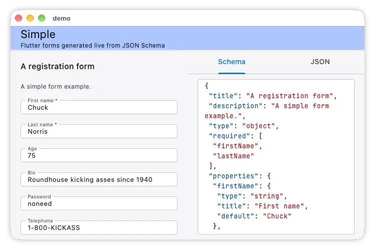

# json_schema_form_builder

Flutter forms generated from JSON Schema — a Flutter counterpart of
[react-jsonschema-form](https://rjsf-team.github.io/react-jsonschema-form/) (RJSF):
typed field editors, live validation, `anyOf`/`oneOf` variants, and an
extensible handler registry.

**[Live demo](https://astoniocom.github.io/json_schema_form_builder/)** — the
showcase app running in the browser.



## Packages

| Package | | |
|---|---|---|
| [`json_schema_form_builder`](packages/json_schema_form_builder) | [pub.dev](https://pub.dev/packages/json_schema_form_builder) | Forms generated from JSON Schema: schema resolution, the state pipeline, validation, variants, and the handler registry. |
| [`form_foundation`](packages/form_foundation) | [pub.dev](https://pub.dev/packages/form_foundation) | Schema-agnostic building blocks for form generators: typed field widgets, editor groups, list scaffolding, and a shared theme. |

`form_foundation` is the presentation layer under `json_schema_form_builder`,
published separately so other form generators can reuse the same widgets.
Each package's README covers its API and usage.

## Repository layout

- `packages/json_schema_form_builder` — the JSON Schema form package;
  `demo/` inside it is the full showcase app (the live demo above),
  `example/` is the minimal pub.dev example.
- `packages/form_foundation` — the widget package; `example/` is a
  hand-written contact form built directly from its widgets.

## Development

The repository is a Dart workspace: one `flutter pub get` at the root
resolves every package.

```sh
flutter pub get
cd packages/json_schema_form_builder && flutter test   # package tests
cd demo && flutter run                                 # the showcase app
```

## License

[MIT](LICENSE).

Some of the demo's sample schemas are taken or adapted from the
[RJSF playground](https://rjsf-team.github.io/react-jsonschema-form/)
([rjsf-team/react-jsonschema-form](https://github.com/rjsf-team/react-jsonschema-form),
Apache-2.0) so the two libraries can be compared on the same schemas.
