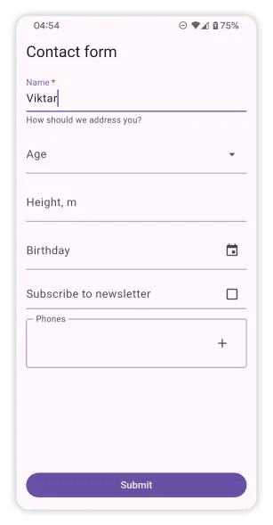

# form_foundation

Schema-agnostic building blocks for **automatic form generators**: typed field
widgets, editor groups, list scaffolding, and a shared theme — the
presentation layer a generator drives, with no schema logic of its own.

This package is the foundation under
[`json_schema_form_builder`](https://pub.dev/packages/json_schema_form_builder)
(forms generated from JSON Schema). It is published separately so that other
generators — a different schema dialect, a server-driven form engine, a
hand-rolled admin panel — can reuse the same widgets and get the same look
without pulling in any JSON Schema machinery.



## Design

- **The app (or the generator) owns the data.** Every widget is
  props-in/callbacks-out: it renders a plain Dart value and reports the edited
  value back. No form state objects, no controllers to manage.
- **The app owns the validation.** Widgets display the error strings they are
  given; they never decide what is valid.
- **One theme for everything.** `FormTheme` / `FormThemeData` configure
  paddings, group frames, and code text style for every widget below them, the
  way Material component themes do.
- **Generator-side contracts are minimal.** `FieldHandler`,
  `FieldHandlerRegistry`, and `NodeState` define just enough for a generator
  to map nodes of its model to editors; nothing in them is specific to any
  schema language.

## What's inside

Typed field widgets — a consistent Material look for the common scalar types:

| Widget | Edits |
|---|---|
| `StringField` | text, with optional `examples` suggestions and `maxLength` |
| `IntField`, `DoubleField` | numbers, with canonicalization on blur |
| `BoolField` | booleans (nullable-aware) |
| `StringDateField`, `StringTimeField`, `StringDateTimeField` | ISO date/time strings via pickers |
| `StringDataUrlField` | binary content as a data URL, via a pluggable `DataUrlFilePicker` |

Structure and scaffolding:

- `EditorGroup` — the framed/expanded container with a title, help text, and
  an error panel; the visual unit of nesting (`EditorGroupView` selects the
  presentation).
- `ListEditor` + `RemovableRow` + `AddButton` — rows with remove buttons,
  reordering, and a typed "add" menu, for collection editors.
- `NodeEditor` — renders a node through a `FieldHandlerRegistry`, the bridge
  a generator plugs its handlers into.
- `CollapsedValueField` — the compact "summary + edit button" representation
  a responsive editor collapses into (`WidthThresholdBuilder` decides when).
- `FormDialog`, `ErrorsPanel`, `FieldLabel` — the dialog wrapper, the error
  list, and the label with the required marker used by all of the above.

## Usage

The widgets compose like any other Flutter widgets; the app keeps the values
and passes errors in:

```dart
FormTheme(
  data: const FormThemeData(
    fieldPadding: EdgeInsets.symmetric(horizontal: 16, vertical: 8),
  ),
  child: Column(
    children: [
      StringField(
        title: 'Name',
        required: true,
        value: name,
        error: name.trim().isEmpty ? 'Name is required' : null,
        onChanged: (value) => setState(() => name = value),
      ),
      EditorGroup(
        title: 'Phones',
        content: Column(
          children: [
            for (final (i, phone) in phones.indexed)
              RemovableRow(
                field: StringField(
                  title: 'Phone ${i + 1}',
                  value: phone,
                  onChanged: (value) => setState(() => phones[i] = value),
                ),
                onRemove: () => setState(() => phones.removeAt(i)),
              ),
          ],
        ),
      ),
    ],
  ),
)
```

The `example/` app is a complete hand-written contact form built this way —
no generator involved.

## When to use what

- You want forms **generated from JSON Schema** — use
  [`json_schema_form_builder`](https://pub.dev/packages/json_schema_form_builder);
  it drives these widgets for you.
- You are **building a form generator** for another schema language or a
  server-driven UI — depend on this package and implement your handlers
  against `FieldHandler` / `FieldHandlerRegistry`.
- You are writing a **custom field handler** for `json_schema_form_builder`
  and want it to match the built-in editors — build its UI from these
  widgets.
