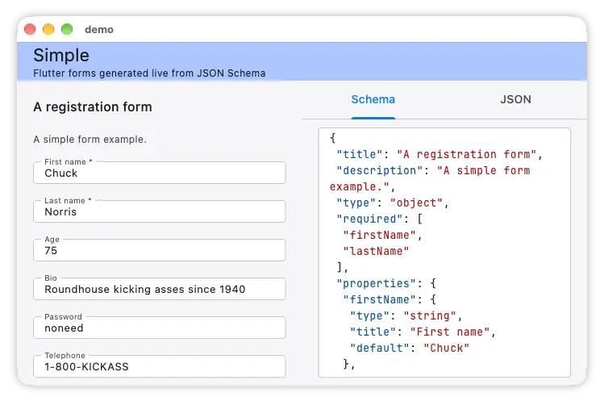

# json_schema_form_builder

Flutter forms generated from JSON Schema: typed field editors, live
validation, `anyOf`/`oneOf` variants, and an extensible handler registry.

Point it at a schema and get an editor tree for the whole document — objects,
arrays, scalars, enums — with validation errors attached to the fields that
caused them. In spirit it is a Flutter counterpart of
[react-jsonschema-form](https://rjsf-team.github.io/react-jsonschema-form/) (RJSF)
and follows its conventions where they translate: variant selection,
`default`/`const` seeding, `readOnly` handling. The demo includes samples
from the RJSF playground so the two can be compared on the same schemas.

**[Live demo](https://astoniocom.github.io/json_schema_form_builder/)** — the
showcase app (sample catalog, schema/JSON editors, validation modes) running
in the browser.



## Features

- **Typed editors for every schema type**: string (with `format`-aware
  date/time/data-url pickers), integer, number, boolean, null, enum, object,
  and array — including draft-07 and 2020-12 tuple forms (`items: [...]` /
  `prefixItems`).
- **`anyOf` / `oneOf` variants**: a selector with the matching alternative's
  editor below it; union types (`type: ["string", "null"]`) get the same
  selector. `const`-pinned and `type: null` alternatives are written by the
  selection itself.
- **Validation while editing**: live (on every change) or on demand, with a
  `SchemaValidationMode` policy deciding whether a schema the bundled
  validator cannot process blocks submission (`strict`) or only warns
  (`lenient`) or stays silent (`none`).
- **Schema resolution**: document-local `$ref` and `allOf` are resolved
  (also inside `default` seeding), and recursive schemas terminate — a
  repeated `$ref` collapses into an "Expand cycle" field instead of
  descending forever.
- **Schema-prescribed values**: `default` and `const` seed new fields,
  `readOnly` renders them uneditable, `description`/`examples` surface in
  the decoration.
- **Schema-less editing**: without a schema the fields are inferred from the
  value, with a type switcher where the value leaves the type open.
- **Theming and localization**: every widget follows
  `FormTheme`/`FormThemeData`; UI strings are bundled for en, pl, ru and
  extensible the standard `Localizations` way.
- **Extensible registry**: replace or add field handlers, plug in a file
  picker, or swap the fallback editor — the built-in wiring is one function.

## Getting started

```yaml
dependencies:
  json_schema_form_builder: ^0.1.0
```

The turnkey widget is `JsonSchemaForm`: uncontrolled, seeded by
`initialValue`, edits flow out through `onChanged`.

```dart
import 'package:json_schema_form_builder/json_schema_form_builder.dart';

final schema = Schema.fromMap({
  'title': 'Person',
  'type': 'object',
  'required': ['name'],
  'properties': {
    'name': {'type': 'string', 'title': 'Name', 'minLength': 1},
    'age': {'type': 'integer', 'title': 'Age', 'minimum': 0},
    'newsletter': {'type': 'boolean', 'title': 'Subscribe', 'default': false},
  },
});

JsonFieldState<Schema>? formState;

JsonSchemaForm(
  schema: schema,
  onChanged: (state) => setState(() => formState = state),
)

// Elsewhere: the current value and the validation verdict.
FilledButton(
  onPressed: (formState?.isValid ?? false)
      ? () => submit(formState!.valueOrNull)
      : null,
  child: const Text('Submit'),
)
```

Register the bundled translations once in your `MaterialApp` (without them
English is used):

```dart
MaterialApp(
  localizationsDelegates: JsonFormLocalizations.localizationsDelegates,
  supportedLocales: JsonFormLocalizations.supportedLocales,
  ...
)
```

The `example/` app is this snippet as a complete runnable form; the `demo/`
app in the repository is the full showcase (sample catalog, schema/JSON
editors, validation modes), also available online as the
[live demo](https://astoniocom.github.io/json_schema_form_builder/).

## Validation on demand

`validateOnChange: false` skips validation during edits; the host triggers it
explicitly — the same pattern as Flutter's `Form`:

```dart
final formKey = GlobalKey<JsonSchemaFormState>();

JsonSchemaForm(key: formKey, schema: schema, validateOnChange: false, ...);

final valid = await formKey.currentState!.validate();
```

## Customization

`JsonSchemaForm` uses `standardJsonHandlerRegistry()` by default; pass a
configured registry for anything beyond the defaults:

```dart
JsonSchemaForm(
  schema: schema,
  registry: standardJsonHandlerRegistry(
    // Which object properties are shown: all, user data only, ...
    displayMode: ObjectFieldDisplayMode.userAndRequired,
    // Inline arrays/objects instead of collapsed edit-in-dialog rows.
    arrayInline: true,
    // Enables the data-url file field for `format: data-url` strings.
    filePicker: myFilePicker,
    // How validator-rejected schemas are treated: strict/lenient/none.
    validationMode: SchemaValidationMode.lenient,
    // Replace a built-in handler (or add your own) per state type.
    overrides: {
      StringFieldState: (getter) => MyStringHandler.registration(getter),
    },
  ),
  ...
)
```

A custom handler extends `JsonFieldHandler`, builds its state in
`buildState`, and renders in `buildField`. Build its UI from the widgets of
[`form_foundation`](https://pub.dev/packages/form_foundation) (this package's
presentation layer) to match the built-in editors.

Hosts that need more control than `JsonSchemaForm` offers — external value
replacement, custom error routing, embedding the JSON text editor
(`JsonEditor`) — assemble the same pipeline by hand: see the repository's
`demo/` app for the reference implementation.

## Relation to form_foundation

The schema-agnostic widgets (field editors, groups, theming) live in
[`form_foundation`](https://pub.dev/packages/form_foundation); this package
contributes everything JSON-Schema-specific: schema resolution, the state
pipeline, validation, variants, and the handler registry that drives those
widgets.
